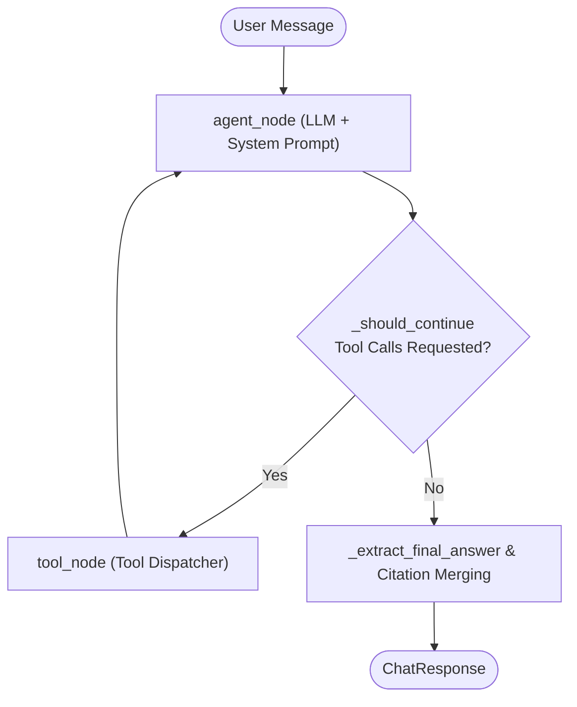
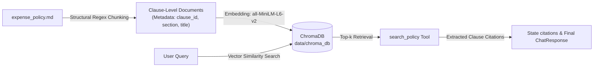
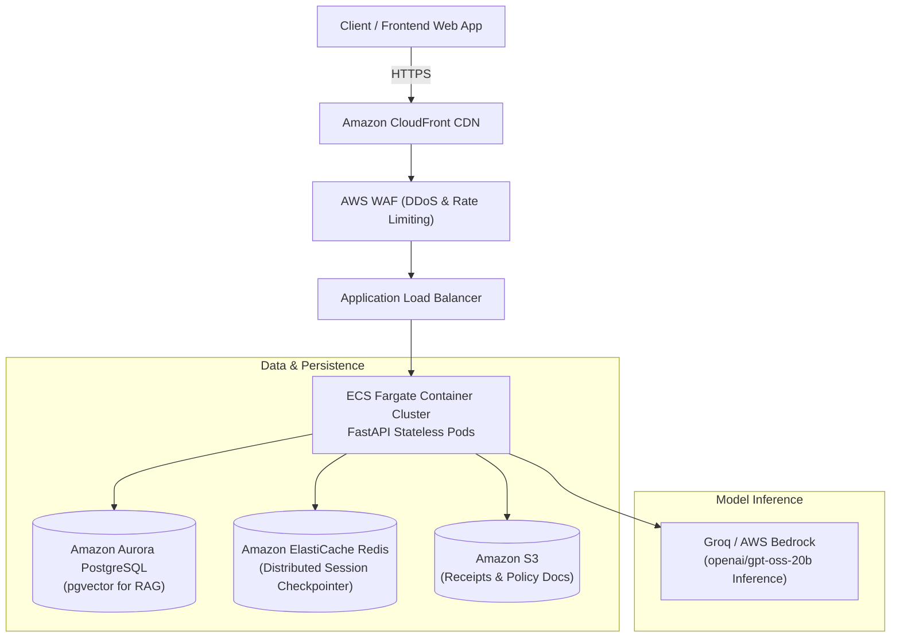

# SpendAssist — Intelligent Expense Management & Policy Chatbot for Company Z

**SpendAssist** is a production-ready, agentic AI assistant designed for **Company Z** (a 600-person engineering services organization). It automates employee expense inquiries, grounds answers in company spending policies via Retrieval-Augmented Generation (RAG), queries corporate card transaction ledgers, and drafts expense claims under strict managerial approval guardrails.

---

## Table of Contents

1. [Executive Summary & Background](#executive-summary--background)
2. [Key Capabilities](#key-capabilities)
3. [Architecture & System Design](#architecture--system-design)
   - [Framework Choice & Justification](#framework-choice--justification)
   - [LangGraph Orchestration State Machine](#langgraph-orchestration-state-machine)
   - [Agent Lifecycle & Termination Logic](#agent-lifecycle--termination-logic)
   - [Tool Schemas & Contracts](#tool-schemas--contracts)
4. [Retrieval-Augmented Generation (RAG) Pipeline](#retrieval-augmented-generation-rag-pipeline)
   - [Structural Regex Chunking](#structural-regex-chunking)
   - [Embedding Model & Vector Store](#embedding-model--vector-store)
   - [Citation Tracking & Propagation](#citation-tracking--propagation)
5. [Enterprise Guardrails & Safety Architecture](#enterprise-guardrails--safety-architecture)
   - [Manager Approval for Write Operations](#1-manager-approval-for-write-operations)
   - [Defense Against Prompt Injection](#2-defense-against-prompt-injection)
   - [Graceful Uncertainty & Out-of-Scope Failsafe](#3-graceful-uncertainty--out-of-scope-failsafe)
   - [Duplicate Claim Prevention](#4-duplicate-claim-prevention)
6. [Repository Structure](#repository-structure)
7. [Getting Started (using `uv`)](#getting-started-using-uv)
   - [Prerequisites](#prerequisites)
   - [Installation & Environment Setup](#installation--environment-setup)
   - [Data Generation & Vector Store Indexing](#data-generation--vector-store-indexing)
   - [Starting the REST API Server](#starting-the-rest-api-server)
8. [Automated Test Suite](#automated-test-suite)
9. [Production Deployment Path (Bonus)](#production-deployment-path-bonus)
   - [Cloud Architecture (AWS)](#cloud-architecture-aws)
   - [Target Latency & SLA](#target-latency--sla)
   - [Cost Analysis per 1,000 Chats](#cost-analysis-per-1000-chats)
   - [Horizontal Scaling Strategy](#horizontal-scaling-strategy)
10. [Future Improvements](#future-improvements)

---

## Executive Summary & Background

Company Z processes approximately **2,500 expense claims per month** across 12 distinct engineering and corporate departments. The finance team handles over **300 recurring monthly inquiries** regarding spend totals, claim eligibility, and remaining department allowances. Furthermore, approximately **1 in 8 claims (~12.5%) is returned** due to policy violations, calculation errors, or duplicate filings.

SpendAssist addresses these operational bottlenecks by providing:
- **Instant spend analytics** with granular transaction-level citations.
- **Authoritative policy answers** mapped directly to specific legal policy clauses.
- **Protected claim drafting** ensuring zero unauthorized ledger writes occur without explicit managerial sign-off.

---

## Key Capabilities

- **Natural Language Spend Queries:** Aggregates spending across employees, departments, expense categories (`travel`, `meals`, `software`, `supplies`), and dynamic time windows (`last quarter`, `this year`, etc.).
- **Deterministic Policy Retrieval:** Uses vector embeddings and exact clause metadata (`Clause 1.1`, `Clause 2.1`, etc.) to ground claims and eliminate hallucinations.
- **Guarded Claim Drafting:** Compiles structured claim drafts marked with `"status": "awaiting_manager_approval"`, validating submission windows (Clause 5.1) and flagging violations before submission.
- **Session-Scoped Memory:** Retains multi-turn conversation context using LangGraph checkpoints (`MemorySaver`), isolating conversational threads per session.

---

## Architecture & System Design

### Framework Choice & Justification

SpendAssist is built using **LangGraph** (with Groq `openai/gpt-oss-20b` as the reasoning engine).

#### LangGraph vs. Alternatives (e.g., CrewAI)
- **Deterministic Control Flow:** CrewAI is optimized for multi-agent narrative collaboration and autonomous task handoffs, which introduces nondeterministic loops unsuitable for audited financial workflows. LangGraph models agent execution as a **directed state machine (StateGraph)**, giving complete deterministic control over loop conditions, branch fallbacks, and node execution.
- **State Checkpointing & Resumability:** LangGraph features built-in checkpointing (`MemorySaver` for in-memory sessions; `PostgresSaver` / `RedisSaver` for production). This provides session isolation and state recovery.

#### Why a Plain "LLM-plus-Code" Approach Fails
A simple while-loop or procedural tool-calling script lacks:
1. **Cyclic State Reducers:** LangGraph's `add_messages` reducer automatically deduplicates, merges, and tracks message turns and internal state transitions without manual list reconstruction.
2. **Standardized ReAct Routing:** A custom loop often struggles with multi-step tool transitions, infinite loops, and exception handling during malformed tool responses.
3. **Execution Limits & Error Boundaries:** Built-in recursion caps and isolated execution nodes prevent runaway API costs and facilitate granular tracing.

#### LLM Selection: Groq (openai/gpt-oss-20b)
1. **Inference Latency:** Multi-agent workflows require sequential tool calls where latency compounds. Groq’s LPU architecture provides near-instantaneous token generation with `openai/gpt-oss-20b`, keeping end-to-end response times under 2 seconds.

2. **Tool-Calling Reliability:** `openai/gpt-oss-20b` is fine-tuned for structured tool calling and JSON outputs, ensuring strict compliance with the application's Pydantic schemas without hallucinating parameters.

3. **Resource Efficiency:** The 20B parameter footprint offers the optimal balance of deep reasoning for RAG synthesis while maintaining a low token footprint, preventing timeout errors during complex multi-turn graph executions.

---

### LangGraph Orchestration State Machine



1. **`agent_node`:** Prepends the immutable `_SYSTEM_PROMPT` to conversation history and calls the LLM with tool schemas bound.
2. **`_should_continue` Router:** Evaluates the last message. If `tool_calls` are present, routes to `tool_node`; otherwise routes to `END`.
3. **`tool_node`:** Dispatches the requested tool (`query_spend`, `search_policy`, or `draft_expense_claim`). It extracts citations, passes clean textual output back into the message stream, and registers drafts in `actions_taken`.
4. **Step Ceiling:** Configured with a hard `recursion_limit: 10` (permitting up to 5 tool round-trips), preventing infinite tool execution loops.

---

### Agent Lifecycle & Termination Logic

| Trigger | Action | Graph State Transition |
|---|---|---|
| User query requires data lookup | Calls `query_spend` or `search_policy` | `agent_node` $\rightarrow$ `tool_node` $\rightarrow$ `agent_node` |
| User requests claim draft | Validates policy via `search_policy`, then calls `draft_expense_claim` | `agent_node` $\rightarrow$ `tool_node` $\rightarrow$ `agent_node` |
| Sufficient information gathered | Synthesizes response with citations | `agent_node` $\rightarrow$ `END` |
| Ambiguous / Out-of-scope query | Returns standard failsafe refusal | `agent_node` $\rightarrow$ `END` |
| Loop threshold reached | `GraphRecursionError` raised | Transformed to HTTP 500 error envelope |

---

### Tool Schemas & Contracts

All tool arguments are strictly validated using **Pydantic v2** models:

#### 1. `query_spend`
- **Purpose:** Read-only querying against `data/transactions.csv`.
- **Input Schema (`QuerySpendInput`):**
  - `employee_id` (*Optional[str]*): ID of the employee (e.g., `EMP-1015`).
  - `department` (*Optional[str]*): Name of department (e.g., `Backend Engineering`).
  - `category` (*Optional[str]*): Permitted category (`travel`, `meals`, `software`, `supplies`).
  - `time_period` (*Optional[str]*): Natural language window (`last quarter`, `this year`, etc.).
- **Output:** Dict `{"result": str, "citations": list[str]}` containing formatted Markdown table and matched `TXN-XXXX` IDs.

#### 2. `search_policy`
- **Purpose:** Semantic similarity RAG lookup against Company Z expense policy.
- **Input Schema:** `query: str`
- **Output:** Dict `{"result": str, "citations": list[str]}` containing retrieved clause excerpts and metadata clause labels (`Clause 1.2`, `Clause 5.1`).

#### 3. `draft_expense_claim`
- **Purpose:** Stages a non-final claim draft awaiting line manager approval.
- **Input Schema (`DraftExpenseClaimInput`):**
  - `employee_id` (*str*): Required employee ID.
  - `amount` (*float*): Non-negative transaction amount.
  - `category` (*str*): Strict category check.
  - `merchant` (*str*): Vendor name.
  - `transaction_date` (*str*): ISO `YYYY-MM-DD` date string.
- **Output:** JSON string containing `draft_id`, claim metadata, and `"status": "awaiting_manager_approval"`.

---

## Retrieval-Augmented Generation (RAG) Pipeline



### Structural Regex Chunking
Rather than naive character-count or recursive splitting, the policy document is parsed using deterministic regular expressions matching Company Z's structured Markdown:
```regex
r"-\s+\*\*Clause\s+([\d.]+)\s+\(([^)]+)\):\*\*\s+(.*)"
```
**Benefits:**
- Clauses are atomic units of legal policy. Structural chunking prevents splitting limits or conditions mid-sentence.
- Preserves section hierarchy (`Section 1: Travel Expenses`, `Section 2: Meal Allowances`).

### Embedding Model & Vector Store
- **Embedding Model:** `sentence-transformers/all-MiniLM-L6-v2` (384-dimensional dense vectors). It runs locally on CPU with near-zero latency, avoiding external embedding API rate limits and network latency.
- **Vector Store:** **ChromaDB** (`langchain-chroma`) persisted locally under `data/chroma_db/`.

### Citation Tracking & Propagation
When `search_policy` retrieves relevant chunks, it pulls `doc.metadata["clause_id"]` (e.g., `Clause 1.2`). The graph's `tool_node` captures these IDs and appends them to `state["citations"]`. In `run_agent()`, citations from tool state and regex extraction from the LLM answer are deduplicated and returned in the HTTP response.

---

## Enterprise Guardrails & Safety Architecture

### 1. Manager Approval for Write Operations
- `draft_expense_claim` **never mutates `transactions.csv` or any database**.
- It creates a staging payload explicitly branded with `"status": "awaiting_manager_approval"`.
- Clause 5.1 check: Transactions older than 30 days trigger an automated policy violation warning within the draft object.

### 2. Defense Against Prompt Injection
- **Immutable System Prompt Ordering:** System instructions are prepended at index 0 on every invocation (`[SystemMessage(_SYSTEM_PROMPT)] + state["messages"]`), preventing conversational drift from overriding instructions.
- **Tool Segregation:** Retrieved document text is passed strictly inside `ToolMessage` payloads, clearly marked as untrusted external data.
- **Pydantic Boundary Validation:** Unsanitized user inputs cannot reach business logic without matching strict data types, enums, and formats.

### 3. Graceful Uncertainty & Out-of-Scope Failsafe
When presented with queries outside company expenses (e.g., requesting IT equipment, hardware replacements, HR grievances), the agent is instructed to avoid hallucination and reply:
> *"I do not have enough information to answer that. I can only assist with Company Z expense queries, policy questions, and drafting expense claims."*

### 4. Duplicate Claim Prevention
- **Clause 5.2 Enforcement:** Before executing a draft, the agent reviews session history for duplicate claims matching the same employee, merchant, amount, and date. If detected, it refuses the draft and cites `Clause 5.2 (Duplicate Claims)`.

---

## Repository Structure

```
spendassist-chatbot/
├── .env.example               # Environment template (GROQ_API_KEY, etc.)
├── .gitignore                 # Standard Python & virtualenv ignores
├── main.py                    # FastAPI application & REST endpoint routes
├── schemas.py                 # Pydantic request/response & tool schemas
├── test_api.py                # Automated 11-scenario edge-case test suite
├── pyproject.toml             # Project dependency specification (PEP 621)
├── agent/
│   ├── __init__.py
│   ├── graph.py               # LangGraph orchestrator, state machine & memory
│   └── tools.py               # query_spend, search_policy, draft_expense_claim
├── data/
│   ├── chroma_db/             # Local ChromaDB persistent vector store
│   ├── expense_policy.md      # Company Z Global Expense Policy document
│   └── transactions.csv       # Mock expense ledger (100 Company Z records)
├── retrieval/
│   ├── __init__.py
│   └── vector_store.py        # RAG pipeline: structural chunking & indexing
└── scripts/
    └── generate_mock_data.py  # Standalone generator for mock transactions
```

---

## Getting Started (using `uv`)

This project uses [`uv`](https://github.com/astral-sh/uv), the extremely fast Python package and project manager.

### Prerequisites
- Python 3.10 or higher
- `uv` installed (`curl -LsSf https://astral.sh/uv/install.sh | sh` on macOS/Linux or `powershell -ExecutionPolicy ByPass -c "irm https://astral.sh/uv/install.ps1 | iex"` on Windows)
- Groq API Key (get one free at [console.groq.com](https://console.groq.com))

### Installation & Environment Setup

1. **Clone the repository:**
   ```bash
   git clone https://github.com/jiaxxuann/spendassist-chatbot.git
   cd spendassist-chatbot
   ```

2. **Create virtual environment and install dependencies:**
   ```bash
   uv venv
   # Windows:
   .venv\Scripts\activate
   # macOS/Linux:
   source .venv/bin/activate

   # Install dependencies
   uv pip install -e .
   ```

3. **Configure Environment Variables:**
   Copy `.env.example` to `.env` and insert your credentials:
   ```bash
   cp .env.example .env
   ```
   Edit `.env`:
   ```ini
   GROQ_API_KEY=gsk_your_groq_api_key_here
   ```

### Data Generation & Vector Store Indexing

1. **Generate Mock Transactions (Company Z business rules):**
   ```bash
   python scripts/generate_mock_data.py
   ```
   *Generates 100 realistic claims across 12 departments, strictly limited to travel/meals/software/supplies, with ~1 in 8 returned.*

2. **Build and Persist the ChromaDB Vector Index:**
   ```bash
   python retrieval/vector_store.py
   ```
   *Performs structural regex chunking on `data/expense_policy.md` and generates vector embeddings locally.*

### Starting the REST API Server

Launch the FastAPI backend using `uvicorn`:
```bash
uvicorn main:app --reload --port 8000
```

Verify service liveness:
```bash
curl http://localhost:8000/health
# {"status": "healthy", "version": "1.0.0"}
```

Interactive OpenAPI documentation is available at [http://localhost:8000/docs](http://localhost:8000/docs).

---

## Automated Test Suite

The automated suite in [`test_api.py`](./test_api.py) runs end-to-end integration tests through the live REST endpoint, covering 11 critical edge cases:

| Test Case | Objective / Edge Case | Expected Behaviour |
|---|---|---|
| **1. Single Employee Aggregation** | CSV role-scoped filtering (`EMP-1015`, travel) | Computes correct sum; cites `TXN-XXXX` IDs |
| **2. Policy Edge Case** | RAG retrieval on software subscriptions | Cites `Clause 3.1` (<$50) and `Clause 3.2` (>$50) |
| **3. The Ghost Hunt** | Filter with 0 matching rows (travel yesterday) | Returns friendly "no transactions" message; 0 citations |
| **4. Truncation Guardrail** | Broad query (entire department for year) | Returns complete department ledger and aggregates |
| **5. Combined Execution** | CSV query + Policy limit check | Answers spend total AND cites `Clause 2.1` ($50 per diem) |
| **6. Multi-Turn Incomplete Draft** | Memory check across 2 conversational turns | Turn 1 gathers amount/ID; Turn 2 completes draft |
| **7. Strict Failsafe** | Out-of-scope IT hardware request | Refuses hallucination; cites Clause 4.2 / failsafe |
| **8. Analytics & Truncation** | Top 5 merchant ranking query | Analyzes and ranks top merchants for the department |
| **9. Duplicate Policy** | Accidental double payment inquiry | Cites `Clause 5.2` prohibiting duplicate submissions |
| **10. Duplicate Claim Attempt** | Memory & policy enforcement on identical drafts | Checks history, cites `Clause 5.2`, and blocks duplicate draft creation |
| **11. Prohibited Item Guardrail** | Prohibited items (alcohol) in client dinners | Retrieves policy, cites `Clause 2.3` and refuses to draft claim |

### Running the Test Suite
Ensure the API server is running on `http://localhost:8000`, then execute:
```bash
python test_api.py
```

---

## Production Deployment Path (Bonus)

### Cloud Architecture (AWS)



### Target Latency & SLA

| Component | Target SLA (p50) | Target SLA (p95) |
|---|---|---|
| REST Gateway & Network Overhead | < 30ms | < 80ms |
| Vector Retrieval (ChromaDB / pgvector) | < 40ms | < 90ms |
| LLM First-Token Latency (Groq) | < 300ms | < 600ms |
| Full End-to-End Turn Latency | **< 1,100ms** | **< 2,200ms** |

### Cost Analysis per 1,000 Chats

Assuming an average conversation consists of **3 turns**, with 800 input tokens and 250 output tokens per turn using Groq's hosted `openai/gpt-oss-20b` (20B parameter pricing tier):

| Resource | Unit Cost | Usage / 1,000 Chats | Total Cost |
|---|---|---|---|
| **LLM Input Tokens (`openai/gpt-oss-20b`)** | $0.20 / 1M tokens | 2.4M tokens | $0.48 |
| **LLM Output Tokens (`openai/gpt-oss-20b`)** | $0.25 / 1M tokens | 0.75M tokens | $0.19 |
| **Embeddings (`all-MiniLM-L6-v2`)** | In-process CPU | Negligible (Local) | $0.00 |
| **Compute (ECS Fargate 0.5 vCPU, 1GB RAM)** | $0.022 / hour | Shared capacity | $0.20 |
| **Vector Store & Checkpointer** | Aurora Serverless / ElastiCache | Shared allocation | $0.35 |
| **Total Estimated Cost per 1,000 Chats** | — | — | **~$1.22** ($0.0012 / chat) |

### Horizontal Scaling Strategy
1. **Stateless Compute:** FastAPI instances run inside Amazon ECS Fargate tasks behind an Application Load Balancer with CPU/Memory Target Tracking autoscaling (scale out when CPU > 70%).
2. **Distributed Checkpointer:** Replace in-memory `MemorySaver` with `PostgresSaver` on Amazon Aurora or `RedisSaver` on ElastiCache, allowing any container to resume any user session instantly.
3. **Database Read Replicas:** Read-heavy transaction queries (`query_spend`) route to Aurora read replicas, isolating operational writes from analytical queries.

---

## Future Improvements

1. **Streaming Responses (SSE / WebSocket):** Implement server-sent events for real-time word-by-word streaming to improve perceived responsiveness.
2. **Role-Based Access Control (RBAC):** Integrate Okta/Azure AD to scope `query_spend` so employees can only view their own transactions, while department heads access aggregate team spending.
3. **Multimodal Receipt OCR:** Integrate vision models (e.g., Llama 3.2 Vision) allowing users to upload photo receipts for auto-extraction of merchant, amount, category, and date.
4. **Interactive Approval Webhooks:** Connect drafted claims to Slack / Microsoft Teams interactive cards, allowing managers to approve or reject claims with one click.
5. **Live ERP Integration:** Replace static CSV ledgers with real-time webhooks connecting to SAP Concur, NetSuite, or Workday.
6. **Dynamic CSV Truncation & Pagination:** Implement server-side pagination or row-capping for very large transaction ledgers (>1,000 records) to conserve LLM context tokens.
